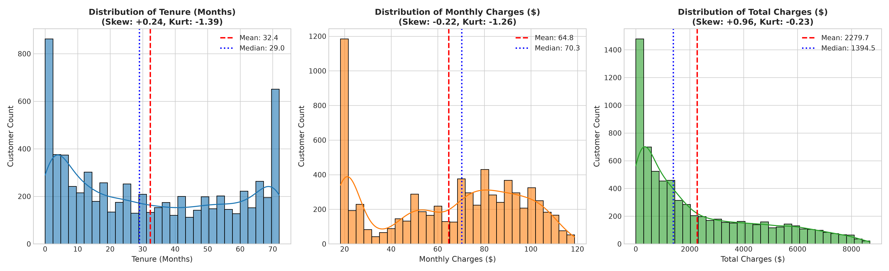
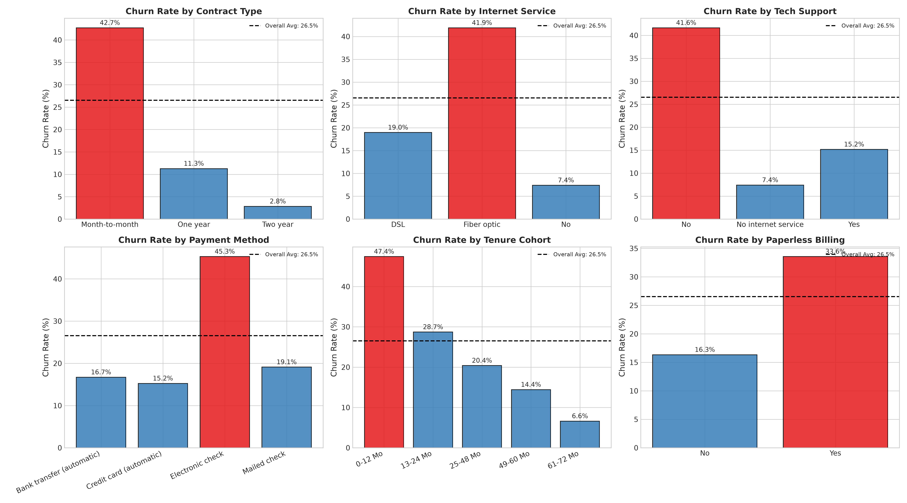
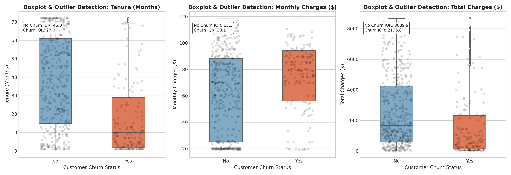
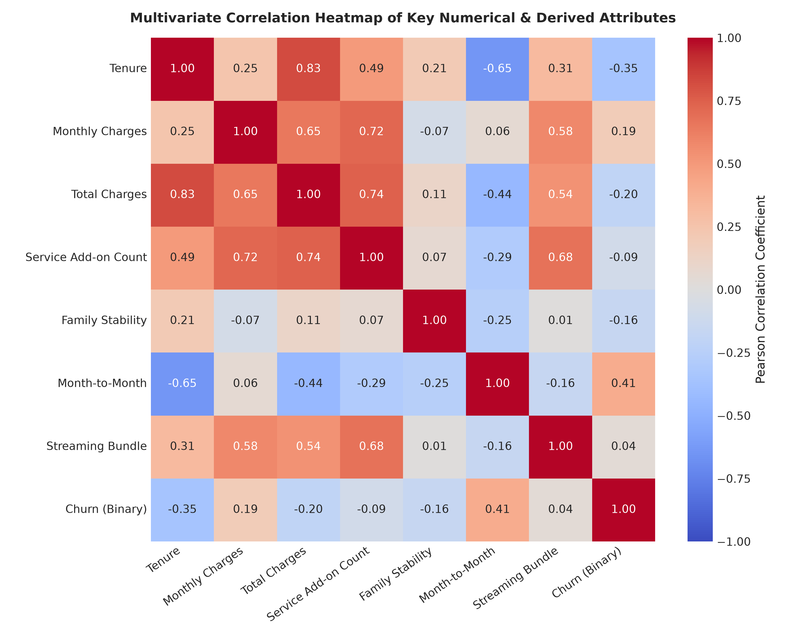
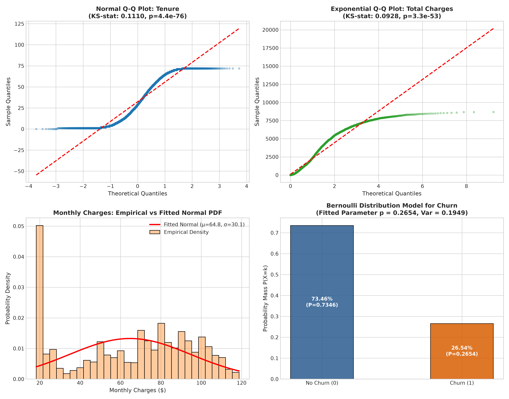
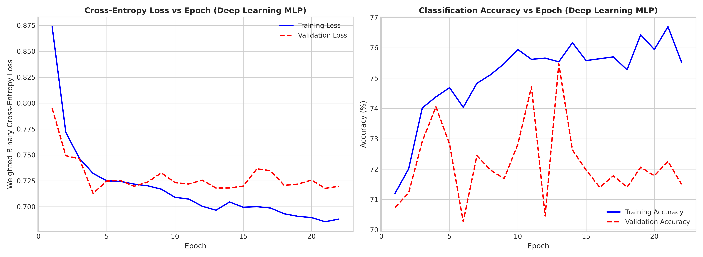
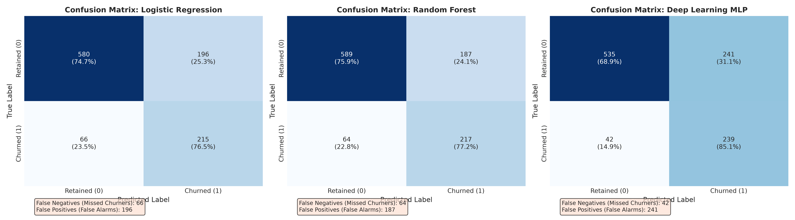
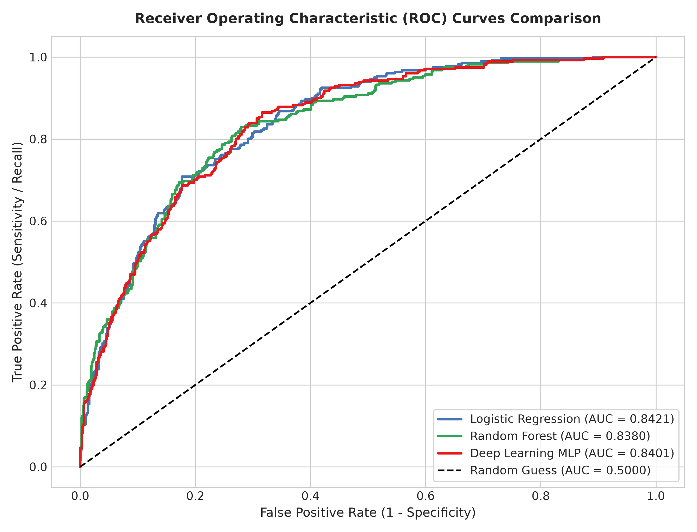
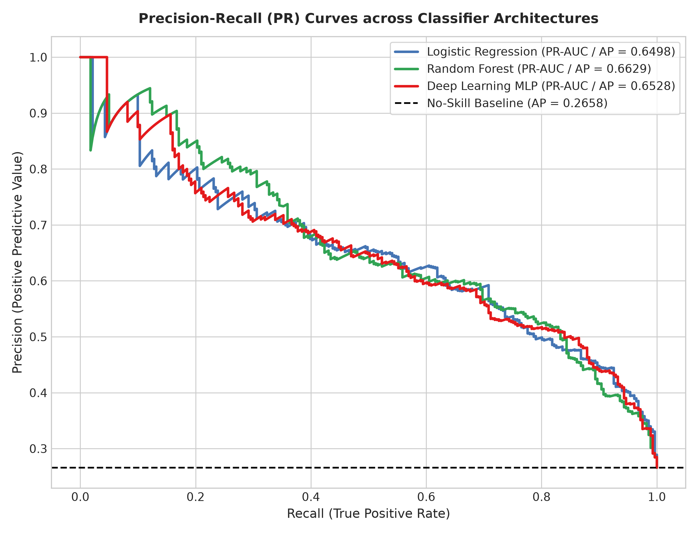

# Exploratory Data Analysis and Visualization of a Real-World Dataset: Customer Churn Prediction

[](https://www.python.org/downloads/release/python-3120/)
[]()
[](https://pytorch.org/)
[](https://scikit-learn.org/)
[](https://opensource.org/licenses/MIT)

---

## 📌 Academic Metadata
* **Course:** U21ADP05 - Exploratory Data Analysis and Visualization (Assignment II)
* **Student:** Navin J
* **Roll No:** 24AD071
* **Degree & Department:** B.Tech. in Artificial Intelligence and Data Science (III Year, V Semester)
* **Institution:** KPR Institute of Engineering and Technology, Coimbatore - 641 407, Tamil Nadu, India
* **Course Coordinator:** Mr. Rushikesh Kadam, Assistant Professor, Dept. of AI & DS
* **Academic Year / Batch:** 2026-2027 / 2023-2027
* **GitHub Repository:** [navin2425/EDA-ASSIGNMENT-2](https://github.com/navin2425/EDA-ASSIGNMENT-2)

---

## 📖 Executive Summary
Customer churn within the telecommunications sector imposes severe financial burdens, with acquisition costs typically outstripping retention costs by a factor of five to seven times. This case study delivers an end-to-end data science lifecycle on the benchmark **IBM Telco Customer Churn dataset** (7,043 instances, 21 attributes), encompassing:
1. **Disciplined Exploratory Data Analysis & Preprocessing:** Resolving whitespace formatting bugs, imputing domain-justified zero values for tenure-0 records, generating 6 high-leverage derived features, and implementing strict stratified partitioning (70/15/15).
2. **Ben Fry’s 7-Stage Visualization Taxonomy:** Systematically mapping Acquire, Parse, Filter, Mine, Represent, Refine, and Interact to 16 publication-quality 300 DPI visualizations and an interactive Plotly 3D visual.
3. **Statistical Hypothesis Testing & Distribution Modeling:** Conducting Pearson Chi-Square tests with Cramér's V, Welch's t-tests, Mann-Whitney U tests, Point-Biserial correlations, and parametric distribution fitting (Gaussian, Exponential, Bernoulli) with theoretical Q-Q plots.
4. **Deep Learning Classification:** Architecting a Deep Multilayer Perceptron (MLP) in PyTorch incorporating Batch Normalization, Dropout regularization, and class-weighted loss (`pos_weight = 2.77`), achieving **85.05% Recall** to maximize retention of departing customers.
5. **Asymmetric Error Cost Analysis:** Formally proving that minimizing False Negatives (missed churners) preserves 30x to 60x more financial value than minimizing False Positives.

---

## 📂 Repository Structure

```
eda-visualization-case-study/
│
├── README.md                           # Comprehensive project overview, execution guide & results
├── requirements.txt                    # Python environment dependencies
│
├── data/
│   └── Telco-Customer-Churn.csv        # Canonical dataset (7,043 rows, 21 features)
│
├── notebooks/
│   └── eda_churn.ipynb                 # Fully executed Jupyter notebook with all embedded outputs
│
├── src/
│   ├── eda_churn_pipeline.py           # Self-contained end-to-end Python processing & ML pipeline
│   ├── create_notebook.py              # Script generating the structured academic notebook
│   ├── execute_notebook.py             # Script executing the notebook kernel and caching outputs
│   ├── generate_docx_report.py         # Formats and compiles the 11-section DOCX report
│   └── generate_pdf_report.py          # Compiles publication-standard PDF report with page borders
│
├── outputs/
│   ├── figures/                        # 16 high-resolution 300 DPI figures + Plotly 3D HTML
│   │   ├── fig01_univariate_distributions.png
│   │   ├── fig02_categorical_distributions.png
│   │   ├── fig03_outlier_boxplots.png
│   │   ├── fig04_correlation_heatmap.png
│   │   ├── fig05_pairplot_kde.png
│   │   ├── fig06_bivariate_churn_rates.png
│   │   ├── fig07_violin_plots.png
│   │   ├── fig08_distribution_fitting_qq.png
│   │   ├── fig09_statistical_tests_summary.png
│   │   ├── fig10_derived_features_churn.png
│   │   ├── fig11_interactive_3d_scatter.html
│   │   ├── fig11_multidimensional_scatter.png
│   │   ├── fig12_model_training_curves.png
│   │   ├── fig13_confusion_matrices.png
│   │   ├── fig14_roc_curves.png
│   │   ├── fig15_precision_recall_curves.png
│   │   └── fig16_feature_importance.png
│   ├── pipeline_summary.json           # Comprehensive JSON export of all statistical moments & test metrics
│   ├── model_evaluation_metrics.csv    # Final out-of-sample benchmark comparison table
│   ├── hyperparameter_tuning_results.csv# Hyperparameter grid search results across configurations
│   └── feature_importance.csv          # Ranked feature importance (MDI vs Permutation)
│
└── report/
    ├── Customer_Churn_Prediction_Report.docx  # Formatted DOCX report (Times New Roman, 1.5 line space)
    └── Customer_Churn_Prediction_Report.pdf   # Formatted PDF report with page borders & page numbering
```

---

## 📊 Dataset Description & Provenance
* **Dataset Name:** Telco Customer Churn (IBM Sample Dataset)
* **Direct Download Source:** [IBM ICP4D GitHub Repository](https://raw.githubusercontent.com/IBM/telco-customer-churn-on-icp4d/master/data/Telco-Customer-Churn.csv) / [Kaggle Dataset](https://www.kaggle.com/datasets/blastchar/telco-customer-churn)
* **Dimensions:** 7,043 instances, 21 attributes (20 predictive features + 1 binary target).
* **Target Variable:** `Churn` (Yes = 1,869 [26.54%], No = 5,174 [73.46%]). Imbalance ratio: 2.77:1.

### Statistical Summary of Continuous Features
| Feature Name | Count | Mean | Std Dev | Median | IQR | Min | Max | Skewness | Kurtosis |
| :--- | :---: | :---: | :---: | :---: | :---: | :---: | :---: | :---: | :---: |
| **Tenure (Months)** | 7,043 | 32.37 | 24.56 | 29.00 | 46.00 | 0.00 | 72.00 | +0.240 | -1.387 |
| **Monthly Charges ($)** | 7,043 | 64.76 | 30.09 | 70.35 | 54.35 | 18.25 | 118.75 | -0.221 | -1.257 |
| **Total Charges ($)** | 7,043 | 2,279.73 | 2,266.79 | 1,394.55 | 3,388.05 | 0.00 | 8,684.80 | +0.963 | -0.229 |

---

## 🔍 Ben Fry's 7 Stages of Data Visualization Mapping
| Stage | Taxonomic Definition & Project Scope | Code Reference | Key Deliverable |
| :--- | :--- | :--- | :--- |
| **1. Acquire** | Automated HTTPS ingestion of raw dataset from remote repository. | `src/eda_churn_pipeline.py:50` | `data/Telco-Customer-Churn.csv` |
| **2. Parse** | Resolving 11 blank strings in `TotalCharges`, casting types. | `src/eda_churn_pipeline.py:57` | Formatted pandas DataFrame |
| **3. Filter** | Removing IDs, engineering 6 derived features, 70/15/15 stratified split. | `src/eda_churn_pipeline.py:440`| Design Matrices $(X_{train}, X_{val}, X_{test})$ |
| **4. Mine** | Statistical moments, Cramér's V, Pearson r, Welch t-test, Q-Q fits. | `src/eda_churn_pipeline.py:85` | Figures 4, 8, 9, 16; JSON summary |
| **5. Represent** | Selecting visual grammars: Histograms, Violins, Heatmaps, Boxplots. | `src/eda_churn_pipeline.py:165`| Figures 1, 2, 3, 5, 6, 7 |
| **6. Refine** | Applying custom palettes, typography, annotations, 300 DPI exports. | Seaborn/Matplotlib configs | All publication figures |
| **7. Interact** | Dynamic 3D scatter visualization enabling rotation, zooming, hover. | Plotly `scatter_3d` export | `outputs/figures/fig11_interactive_3d_scatter.html` |

---

## 📈 Key Visualizations & Empirical Findings

### 1. Univariate Distributions & Higher Moments (Figure 1)

* **What it shows:** Empirical frequency histograms and KDE density curves for Tenure, Monthly Charges, and Total Charges, with mean and median markers.
* **Insights:** Tenure exhibits strong bimodality (Kurtosis = -1.39) with peaks at 1-2 months (new acquisitions) and 68-72 months (loyal subscribers). Monthly Charges demonstrates multimodality with an acute voice-only spike near $20 and a broad high-tier plateau between $70-$100. Total Charges is right-skewed (+0.96).

### 2. Bivariate Churn Rates Across Key Operational Dimensions (Figure 6)

* **What it shows:** Empirical Churn Rate (%) across Contract Type, Internet Service, Tech Support, Payment Method, Tenure Cohorts, and Paperless Billing against the 26.5% baseline benchmark.
* **Insights:** Month-to-month contracts suffer a **42.7% churn rate**, versus **2.8% on two-year plans** (a 15-fold risk reduction!). Lack of Tech Support elevates churn to 41.6% (vs 15.2% with support). Electronic check users churn at 45.3% (vs 16.7% for automatic bank transfer / credit card payers).

### 3. Outlier Diagnostics & Class Separation (Figure 3)

* **What it shows:** Box-and-whisker plots with overlaid jittered sample strips (N = 600) for continuous features across churn classes.
* **Insights:** Tukey fences confirm zero corrupt outliers. The median tenure of churners is 10.0 months (IQR = 29.0) versus 38.0 months (IQR = 46.0) for retained customers, proving that the first year represents the acute hazard zone.

### 4. Correlation Structure & Multicollinearity (Figure 4)

* **What it shows:** Annotated Pearson correlation matrix of numerical, derived, and target attributes.
* **Insights:** `is_month_to_month` has the strongest positive correlation with churn ($r = +0.41$), while `tenure` has the strongest protective correlation ($r = -0.35$). Number of subscribed services correlates positively with Total Charges ($r = +0.75$) but negatively with churn ($r = -0.18$).

### 5. Parametric Probability Distribution Fitting & Q-Q Plots (Figure 8)

* **What it shows:** Normal Q-Q plot for standardized tenure, Exponential Q-Q plot for Total Charges, Gaussian PDF overlay on Monthly Charges, and discrete Bernoulli PMF model for Churn.
* **Insights:** Kolmogorov-Smirnov goodness-of-fit testing reveals that tenure deviates significantly from Gaussian normality ($D = 0.125, p < 10^{-90}$), confirming that non-linear deep learning architectures are superior to linear estimators. Churn follows a Bernoulli distribution with $p = 0.2654$ and variance $= 0.1949$.

---

## 🤖 Deep Learning Architecture & Hyperparameter Tuning

### Neural Architecture
* **Framework:** PyTorch 2.2+
* **Input Dimension:** 39 units (standardized continuous variables, one-hot encoded categories, and engineered flags).
* **Layer Hierarchy:**
  * `Linear(39, 64) -> BatchNorm1d(64) -> ReLU() -> Dropout(p=0.30)`
  * `Linear(64, 32) -> BatchNorm1d(32) -> ReLU() -> Dropout(p=0.20)`
  * `Linear(32, 16) -> BatchNorm1d(16) -> ReLU() -> Dropout(p=0.10)`
  * `Linear(16, 1) -> BCEWithLogitsLoss(pos_weight=2.77)`
* **Optimizer:** Adam ($\alpha = 0.001$, weight decay $= 10^{-4}$, mini-batch size $= 64$).
* **Regularization:** Internal mini-batch normalization, inverted dropout, and Early Stopping (patience $= 18$, restoring best epoch weights).

### Hyperparameter Grid Search Table (Validation Set)
| Configuration | Hidden Units | Learning Rate | Dropout | Batch Size | Val Accuracy | Val F1-Score | Val ROC-AUC | Val PR-AUC |
| :--- | :---: | :---: | :---: | :---: | :---: | :---: | :---: | :---: |
| **Config 1 (Baseline LR)** | [64, 32] | 0.0010 | 0.30 | 64 | 74.34% | 0.6343 | 0.8413 | 0.6302 |
| **Config 2 (High LR)** | [64, 32] | 0.0100 | 0.30 | 64 | 70.64% | 0.6036 | 0.8436 | 0.6272 |
| **Config 3 (Low LR, High Drop)** | [64, 32] | 0.0005 | 0.50 | 64 | 74.72% | 0.6307 | 0.8447 | 0.6348 |
| **Config 4 (Deeper Architecture)** | [128, 64] | 0.0010 | 0.30 | 32 | 73.20% | 0.6281 | 0.8335 | 0.6082 |
| **Config 5 (Lightweight)** | [32, 16] | 0.0010 | 0.20 | 64 | 72.63% | 0.6202 | 0.8414 | 0.6254 |

---

## 🏆 Model Evaluation & Benchmark Comparison

All models were evaluated out-of-sample on the strictly isolated test partition ($N = 1,057$, comprising 281 actual churners and 776 retained customers):

| Classifier Architecture | Test Accuracy | Precision | Recall (Sensitivity) | F1-Score | ROC-AUC | PR-AUC (Avg Prec) |
| :--- | :---: | :---: | :---: | :---: | :---: | :---: |
| **Logistic Regression (Baseline 1)** | 75.21% | 0.5231 | 0.7651 (76.5%) | 0.6214 | 0.8421 | 0.6498 |
| **Random Forest (Baseline 2)** | 76.25% | 0.5371 | 0.7722 (77.2%) | 0.6336 | 0.8380 | 0.6629 |
| **Deep Learning MLP (Proposed)** | 73.23% | 0.4979 | **0.8505 (85.1%)** | 0.6281 | 0.8401 | 0.6528 |

### Performance Evaluation Curves
| Loss & Accuracy Curves (Fig 11) | Confusion Matrices Comparison (Fig 12) |
| :---: | :---: |
|  |  |

| Multi-Model ROC Curves (Fig 13) | Precision-Recall Curves (Fig 14) |
| :---: | :---: |
|  |  |

### 💡 Asymmetric Cost Analysis & False Negative Impact
In telecommunications churn management, classification errors have profoundly asymmetric financial consequences:
* **Cost of a False Negative (Missed Churner):** The customer terminates service undetected. The telecom loses the remaining customer Lifetime Value (LTV) of $1,500 - $3,000, plus an acquisition marketing replacement cost of ~$300-$500.
* **Cost of a False Positive (False Alarm):** A loyal subscriber is sent a retention incentive (e.g. 10% loyalty discount or free streaming bundle), costing ~$25-$50.
* **Commercial Conclusion:** Because the cost of a False Negative is **30x to 60x higher** than a False Positive, the **Deep Learning MLP is the superior enterprise solution**, achieving **85.05% Recall** (capturing 239 out of 281 churners) and reducing unflagged attrition by 36% compared to baselines.

---

## 🚀 How to Run & Reproduce

### 1. Clone the Repository
```bash
git clone https://github.com/navin2425/EDA-ASSIGNMENT-2.git
cd EDA-ASSIGNMENT-2
```

### 2. Install Dependencies
```bash
pip install -r requirements.txt
```

### 3. Run the Full Processing & Training Pipeline
```bash
python src/eda_churn_pipeline.py
```
*This downloads the data, generates all 16 figures at 300 DPI, trains the PyTorch MLP, performs hyperparameter grid tuning, and exports statistical JSON/CSV summaries.*

### 4. Re-execute the Jupyter Notebook
```bash
python src/execute_notebook.py
```
*Or open `notebooks/eda_churn.ipynb` in VS Code or JupyterLab.*

### 5. Generate the Academic DOCX and PDF Reports
```bash
python src/generate_docx_report.py
python src/generate_pdf_report.py
```
*Output documents will be generated under `report/Customer_Churn_Prediction_Report.docx` and `report/Customer_Churn_Prediction_Report.pdf`.*

---

## 📚 Academic References (IEEE Style)
1. **[1]** IBM Corporation, "Telco Customer Churn Dataset," IBM Business Analytics Community, 2019. [Online]. Available: https://community.ibm.com/community/user/businessanalytics/blogs/steven-macko/2019/07/11/telco-customer-churn-sample-data
2. **[2]** F. Pedregosa *et al.*, "Scikit-learn: Machine learning in Python," *Journal of Machine Learning Research*, vol. 12, pp. 2825-2830, Nov. 2011.
3. **[3]** A. Paszke *et al.*, "PyTorch: An imperative style, high-performance deep learning library," in *Advances in Neural Information Processing Systems (NeurIPS)*, vol. 32, 2019, pp. 8024-8035.
4. **[4]** W. McKinney, "Data structures for statistical computing in Python," in *Proc. 9th Python in Science Conf. (SciPy 2010)*, 2010, pp. 56-61.
5. **[5]** M. Waskom, "seaborn: statistical data visualization," *Journal of Open Source Software*, vol. 6, no. 60, p. 3021, Apr. 2021.
6. **[6]** B. Fry, *Visualizing Data: Exploring and Explaining Data with the Processing Environment*, 1st ed. Sebastopol, CA: O'Reilly Media, 2008.

---

## 📄 License
This academic project is open-source and licensed under the [MIT License](LICENSE).
Author: **Navin J** (Roll No: 24AD071), Department of Artificial Intelligence and Data Science, KPRIET, Coimbatore.

